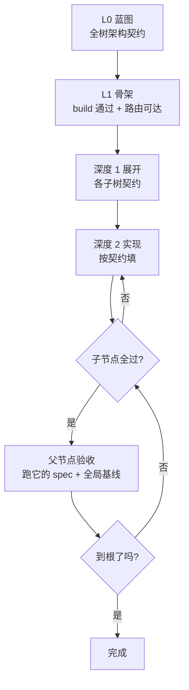

# 编排设计：层级式

> **本文是设计**，不是补丁方案。旧架构（codegen 分支、骨架轮、DFS 排序）按**整体替换**处理，
> 不保留、不回退、不共存。落地清单见 `MIGRATION.md`。
>
> 内核（CCB）不动。全部改动都在「需求树 → 内核 → 代码树」这一段。

---

## 0. 一句话

**需求不是任务清单，是精度层级。每一层都是一个完整的 app，只是越来越细。**

---

## 1. 两种世界观

|  | DFS（旧） | 层级（新） |
|---|---|---|
| 需求是什么 | 任务清单 | 精度层级 |
| 怎么推进 | 做完一个划掉一个 | 每层都是完整 app，逐层加精度 |
| 整体性 | 清单全划掉 = 完成 | **每一层都完整** |
| 单个节点验收什么 | 它自己的 spec | 它的 spec **+ 全局基线** |

**判别式 —— 跑到一半，app 是完整的吗？**

| | 中间态 |
|---|---|
| DFS | 残缺。只有前几个节点的功能，后面全是洞 |
| 层级 | 完整。能 build、能跑、只是功能少 |

**这一条区别决定了一切。** 在 DFS 结构里，「全局」这个概念**只在最后才存在**
——所以每个节点的验收**结构上不可能**是全局的。不是检测写得不好，是它被放在那个
位置，就只看得见自己。这个补丁补不出来，只能换结构。

---

## 2. 三个不变式

**整个编排就是这三条。** 它们不是流程，是对**任意时刻系统状态**的约束。

### ① 实现方向 —— 从大到小

> 任何时刻，正在被实现的节点，它的**全部祖先契约都已经存在**。

一个节点永远不会在「不知道自己该长什么样」的情况下开工。

### ② 验收方向 —— 从小到大

> 一个节点的 spec 通过 ⟹ 它的**整棵子树都通过**。

父节点不是「第一个做出来的」，是「**最后才成立的**」。它的验收等它的子节点全部完成。

> **这条直接回答了那个老问题**：顶层节点不需要做出整个 app。
> 因为**顶层节点的验收发生在最后，不在开头**。
> 当时的顾虑之所以成立，是因为默认了「节点做完就立刻验收」这个 DFS 假设。
> 拆掉这个假设，矛盾就没了。

### ③ 单调性 —— 放大视野的修复

> 通过的东西只能增加。破坏 = 立刻回滚 + 告诉它破坏了谁。

---

## 3. 结构

### 3.1 需求树 → 精度层级

```
REQ-1        订票系统                    深度 0
├ REQ-1.1    搜索                        深度 1
│ ├ 1.1.1    按时间排序                  深度 2
│ └ 1.1.2    按价格筛选                  深度 2
└ REQ-1.2    下单                        深度 1
  └ 1.2.1    选座                        深度 2
```

### 3.2 阶段与完成标准

| 阶段 | 做什么 | **完成标准** |
|---|---|---|
| **L0 蓝图** | 读全部需求 + 全部 spec，产出**架构契约**：数据模型、目录布局、路由命名、UI 骨架 | 契约自洽（结构检查，不用 LLM） |
| **L1 骨架** | 按契约搭空壳：每个声明的路由存在（占位实现）、每个页面存在 | **`npm run build` 通过 + 所有声明的路由可达** |
| **深度 1** | REQ-1.1 / REQ-1.2 各自**展开**自己子域的契约 | 契约在 L0 约束下自洽 |
| **深度 2** | 1.1.1 / 1.1.2 / 1.2.1 **按契约实现** | 各自的 spec 通过 **+ 全局基线不破** |
| **聚合** | 子节点全过 → 父节点变可验收 → 递归向上 | 父节点的 spec 通过 |

**「每一层有自己的完成标准」是这套设计的心脏。**
L1 的标准是「架子在」，**不是「功能对」** —— 所以 L1 不需要提前实现任何 REQ，
它只保证**后面每一个 REQ 都有地方可落**。

### 3.3 关键：层是依赖结构，不是调度时钟

**不要求全局同步。** 不变式 ①② 约束的是**局部完整性**：

- ① 要求「祖先契约存在」，不是「所有同层节点的契约都存在」
- ② 要求「子树全过」，不是「所有同层全过」

⇒ REQ-1.1 的子树做完了，REQ-1.1 就结案，**不用等 REQ-1.2 的子树**。
⇒ 某个分支特别深也不会拖住别的分支。

所以「层边界」不是一个全局节拍。**检查点的位置由不变式决定，不由时钟决定**：

| 时刻 | 触发什么 |
|---|---|
| 一个叶子节点实现完 | 跑它的 spec **+ 全局基线**（不变式 ③） |
| 一个节点的**所有子节点都通过** | 该节点**自动变为可验收**，跑它自己的 spec（不变式 ②） |
| 递归向上 | 直到根 |

**这就是「从小到大验收」的精确机制** —— 每做完一个东西，往上检查它让什么变得完整了。

### 3.4 执行序



**实现往下走，验收往上走。** 这个对称就是全部。

---

## 4. 原则：把智能还给模型

旧架构的根病是 **harness 替模型做预测** —— 排序源码、算配额、打包上下文、
猜模型需要看什么。15 个模式分支就是这么长出来的。

**新架构里 harness 只做两件事：给足信息、验全局。剩下的决定权全在模型。**

### 4.1 一个节点开工时拿到什么

| 输入 | 内容 | 作用 |
|---|---|---|
| **全局契约** | L0 产出的数据模型 / 目录 / 路由命名 / UI 骨架 | 我不越界 |
| **子树契约** | 本节点展开的子契约（如果它还有下层） | 我要交付的形状 |
| **祖先链** | 从根到本节点的需求路径 | 我在哪 |
| **向前依赖** | **谁依赖我**（从契约反查） | 我改动的爆炸半径 |
| **本节点 spec** | 它要满足的测试 | 我的底线 |
| **工具** | Read / Write / Edit / Grep / Glob / Bash | **自己去取需要的一切** |

### 4.2 harness 不做什么

| 不做 | 为什么 |
|---|---|
| 不排序源码 | 模型有 Grep/Glob，自己找 |
| 不算上下文配额 | 模型有 Read，自己读 |
| 不打包引用 | 模型有工具，自己取 |
| 不预测模型需要什么 | **这是把智能从模型手里拿走** |

**唯一的硬约束是契约。** 契约不是限制模型，是**让模型知道自己的边界在哪**
—— 它保证了 A 和 B 各自做的那一半能拼上，而不需要 A 去猜 B 做了什么。

---

## 5. 修复的视野 = 往上看

分层把破坏关系从**任意**变成了**单向**：

```
分层前：A 可能弄坏 B，B 可能弄坏 A，谁也看不见谁   ← 无向、不可预测
分层后：上层依赖下层。下层被改坏，上层才受影响     ← 单向、已知
```

而层间依赖是**从契约来的**，是**已知的** —— 不需要从 git 历史猜，不需要事后诊断。

**「放大视野的修复」具体就是一句话：我要改的东西，哪些上层依赖它。**

这个信息在不变式 ① 下永远存在，因为契约就在那里。

### 5.1 修复时模型看到什么

- **向后**：祖先链（我为什么是现在这样）
- **向前**：谁依赖我（我改坏了会伤到谁）
- **底线**：**全局基线的完整清单**（已经通过的全部 spec）
- **硬约束**：改任何东西之前，先确认基线里没有一条会因此变红

### 5.2 失败信息长什么样

不变式 ③ 让失败信息天然带视野：

> 你的改动让 `REQ-3.2` 的 spec 变红了。它在你动手之前是通过的。

模型不需要被告知「要小心」，它**直接看到了自己破坏了什么**。

---

## 6. 模块划分

| 新组件 | 职责 | 取代 |
|---|---|---|
| **分层器** | 需求树 → 深度层级 + 每个节点的祖先链 | `topo_order`（DFS 近似，`requirement_order.py:49`） |
| **契约** | L0 全局契约 + 每个节点展开的子契约。既是实现约束，也是聚合验收与「向前依赖」的依据 | 旧骨架轮（一个 codegen 前置 hack） |
| **实现器** | 契约 + 本节点 spec + 祖先链 + 向前依赖 → 实现。**只有工具模式** | codegen 整条链 |
| **聚合验收器** | 叶子验 → 向上聚合 → 层内验 + 全局基线。单调只增 | `acceptance_loop` / `final_acceptance` |
| **视野器** | 从契约取反向依赖，输出「谁依赖我」+ 全局基线清单 | 无对应物 |

---

## 7. 这套设计治好了什么

| 旧架构的病 | 层级式为什么不会得 |
|---|---|
| A 弄坏 B 却得分（局部最优） | 验收范围 = 本节点 + **全局基线**；破坏立刻回滚（③） |
| 修不好的时候看不到自己破坏了什么 | 失败信息由基线产生，**天然带视野**（5.2） |
| 顶层架构意图被丢掉，每个节点各自定架构 | **L0 契约 + 逐层展开**，形状提前定死（①） |
| 跑到最后才发现拼接不上 | 每一层的中间态都是**完整可运行**的，拼接问题在当层就暴露 |
| 坏地基上继续建 | 向上聚合（②）：子节点全过，父节点才成立 |
| 15 个模式分支，每个决策点都要问「走哪条路」 | **只有一个模式**，没有分支 |

---

## 8. 待定（需要在开工前定）

### 8.1 契约的粒度

契约太粗 → 节点还是要自己定形状，拼接问题回来了。
契约太细 → 等于提前写完整个 app，失去分层意义。

**建议**：契约只定**跨节点可见的东西** —— 数据模型、路由名、共享文件的分工边界。
不定义任何节点内部怎么实现。

### 8.2 L1 骨架的边界

骨架阶段由谁做？一次调用？还是按契约机械生成？

**建议**：一次工具回合，产出标准是「build 通过 + 路由可达」这个**可机械验证**的条件。
它不写任何业务逻辑。

### 8.3 深度不齐时的收敛

不变式 ①② 天然允许子树独立推进（3.3）。但**根节点的验收**要等所有子树 ——
这是唯一的全局同步点，也是最后一步。需要确认时间预算够走到那里。
